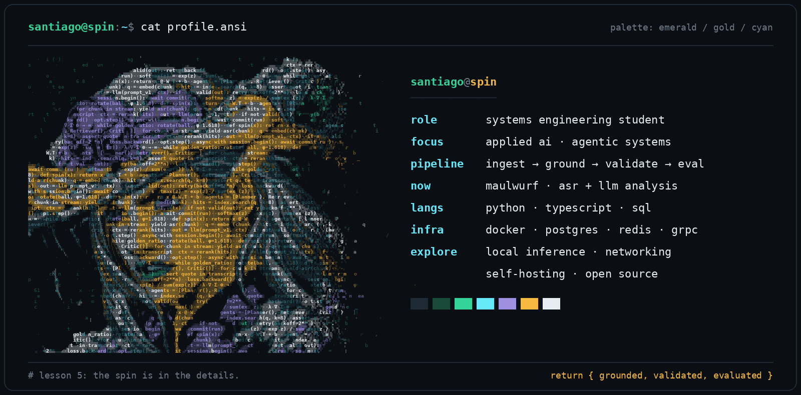

<div align="center">
  
</div>

<br/>

<div align="center">
  
</div>

<br/>

Systems Engineering student focused on **applied AI**: LLM pipelines, agentic systems and local model inference.
I build the engineering around models (ingestion, grounding, validation and evaluation), and I have hands-on experience with multi-agent workflows.

<br/>

## `01` &nbsp;Selected projects

<table>
  <tr>
    <td width="24%" valign="top">
      <a href="https://github.com/Nigrumhodo/Maulwurf"><b>Maulwurf</b></a><br/>
      <sub>Team project · in active development</sub>
    </td>
    <td valign="top">
      Privacy-first academic assistant: class recordings become searchable transcripts, cited RAG answers and human-confirmed calendar tasks, without storing audio.
      <br/><br/>
      <sub><b>My role:</b> second-largest contributor (24 merged PRs). Speech-recognition ingestion service (NVIDIA Riva over gRPC, bounded ffmpeg streaming, backpressure, verified in-memory audio cleanup) and the LLM analysis pipeline (windowed extraction, exact-quote validation, timezone-aware date resolution, versioned prompts with regression tests, reproducible evaluation).</sub>
      <br/><br/>
      <code>Python</code> <code>FastAPI</code> <code>PostgreSQL + pgvector</code> <code>Redis / ARQ</code> <code>gRPC</code> <code>Docker Compose</code>
    </td>
  </tr>
  <tr>
    <td width="24%" valign="top">
      <a href="https://github.com/satnovaOG/ClearFlow"><b>ClearFlow</b></a><br/>
      <sub>Assistive technology</sub>
    </td>
    <td valign="top">
      Real-time classroom captioning for deaf students in higher education, with per-course session logs and LLM-generated summaries and study guides. Grounded in Universal Design for Learning.
      <br/><br/>
      <code>Python</code> <code>SpeechRecognition</code> <code>Gemini API</code> <code>CustomTkinter</code> <code>uv</code>
    </td>
  </tr>
  <tr>
    <td width="24%" valign="top">
      <a href="https://github.com/satnovaOG/LumenKids"><b>LumenKids</b></a><br/>
      <sub>Education platform</sub>
    </td>
    <td valign="top">
      Free learning platform for students aged 10–18 in underserved areas of Barranquilla: role-based system with a relational schema, REST API, course and quiz builder with automatic grading, and progress tracking.
      <br/><br/>
      <code>Node.js</code> <code>Express</code> <code>PostgreSQL</code> <code>SQL</code>
    </td>
  </tr>
</table>

<br/>

## `02` &nbsp;Stack

<sub>Limited to what the projects above actually use.</sub>

<table>
  <tr>
    <td width="24%"><b>Languages</b></td>
    <td>
      
      
      
      
    </td>
  </tr>
  <tr>
    <td><b>AI / ML</b></td>
    <td>
      
      
      
      
      
    </td>
  </tr>
  <tr>
    <td><b>Backend &amp; data</b></td>
    <td>
      
      
      
      
      
    </td>
  </tr>
  <tr>
    <td><b>Infra &amp; tooling</b></td>
    <td>
      
      
      
      
      
      
      
    </td>
  </tr>
</table>

<br/>

## `03` &nbsp;Current focus & interests

```yaml
main_focus: applied AI   # agentic and multi-agent systems, running models locally
exploring:  [systems & low-level infrastructure, networking, self-hosting, open source]
```

<br/>

## `04` &nbsp;Activity

<picture>
  <source media="(prefers-color-scheme: dark)" srcset="https://raw.githubusercontent.com/satnovaOG/satnovaOG/output/snake-dark.svg" />
  <source media="(prefers-color-scheme: light)" srcset="https://raw.githubusercontent.com/satnovaOG/satnovaOG/output/snake-light.svg" />
  
</picture>

<br/>

---

<div align="center">

[](https://www.linkedin.com/in/santiago-montealegre-196577264/)
[](https://forms.gle/8okjDNWUd58Nf8mu6)

</div>
